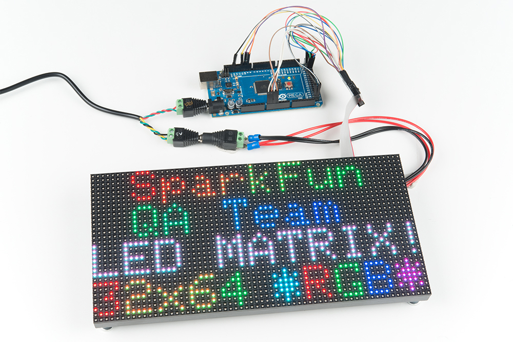
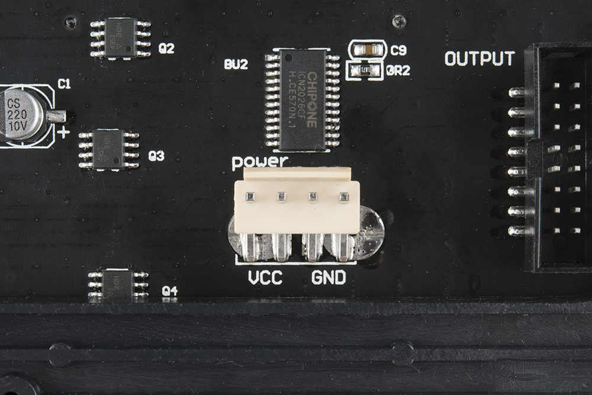
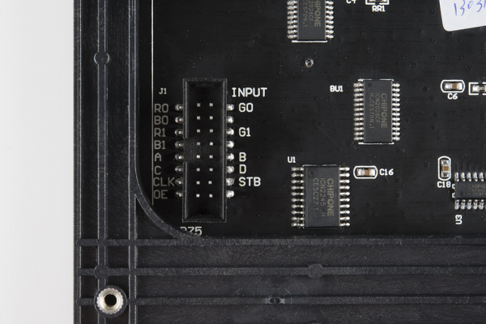

# 16x32 LED Matrix.md

LED Matrices come in many sizes. At hackSpace, we have the **16x32 LED Matrix**:

- 2048 pixels (6144 total LEDs!) 32x64 pixel panel with 1:16 scan rate measuring 5x10"

-----------
## HARDWARE

- 16x32 LED Matrix

- Power Supply (use only the one provided with the KIT)

- Arduino MEGA (Arduino UNO doesn't have enough capacity)

-----------
## WIRING

- Plug the Matrix Power cable into the Matrix Power slot. See images above.

- Find the INPUT slot as in the image above.

- Finally, Power the Matrix using the provided Power Supply. 

-----------
## More about the LED Matrix

[Sparkfun hookup Guide](https://learn.sparkfun.com/tutorials/rgb-panel-hookup-guide/all)
